<div align="center">

# PhishLens

### **See through the deception.** Hands-on phishing & social-engineering training, with a disposable sandbox machine for every lesson.

[](https://react.dev/)
[](https://www.typescriptlang.org/)
[](https://tailwindcss.com/)
[](https://vitejs.dev/)
[](https://motion.dev/)
[](#sandbox-labs-a-disposable-machine-for-every-lesson)
[](#license)

<p align="center">
  <strong>PhishLens</strong> replaces passive awareness slides with realistic, interactive environments. Learners step into simulated inboxes, sign-in pages, SMS threads, QR scanners and support chats, then go deeper in <strong>isolated sandbox labs</strong>: throwaway workstations that boot inside the browser with their own mail client, web browser, file manager and forensic terminal.
</p>

<p align="center">
  <a href="#preview">Preview</a> ·
  <a href="#sandbox-labs-a-disposable-machine-for-every-lesson">Sandbox Labs</a> ·
  <a href="#guided-simulation-rooms">Rooms</a> ·
  <a href="#personal-recognition-report">Report</a> ·
  <a href="#design-system--motion">Design & Motion</a> ·
  <a href="#architecture">Architecture</a> ·
  <a href="#getting-started">Getting Started</a> ·
  <a href="#deployment">Deployment</a>
</p>

</div>

---

## Preview

<div align="center">
  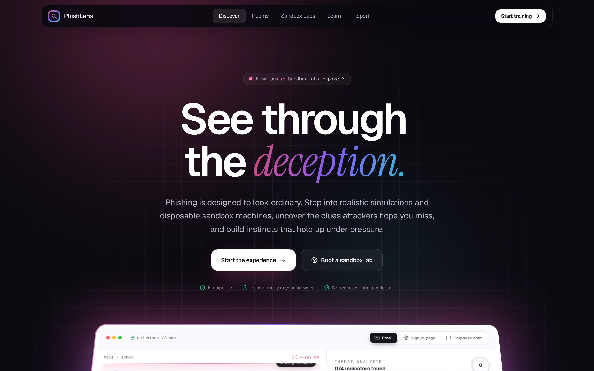
  <p><em><strong>Landing hero:</strong> word-by-word headline reveal, drifting aurora backdrop, magnetic call-to-action buttons and a floating glass navigation bar.</em></p>
</div>


---

## Why PhishLens

Most phishing succeeds not because people lack theory, but because real interfaces hide the evidence behind familiar display names, padlocks, urgency and polish. Multiple-choice quizzes rarely prepare anyone for the split-second pressure of a real lure.

PhishLens is built around an action-first learning loop:

$$\text{Experience} \longrightarrow \text{Decide} \longrightarrow \text{Discover} \longrightarrow \text{Understand} \longrightarrow \text{Practise} \longrightarrow \text{Improve}$$

| Layer | What the learner does | Where |
| :--- | :--- | :--- |
| **Guided rooms** | Five short, scaffolded investigations, each in a different medium, with hints and instant feedback | `/experience/simulation/sim-1…5` |
| **Sandbox labs** | Free-form investigations inside an isolated virtual workstation, with real tools and real consequences, all contained | `/labs` |
| **Threat guides** | Annotated examples, before/after habit comparisons and spot-check questions for 8 attack families | `/learn` |
| **Report** | A behaviour-based summary across rooms and labs, exportable as PDF | `/report` |

---

## Sandbox Labs: a disposable machine for every lesson

<div align="center">
  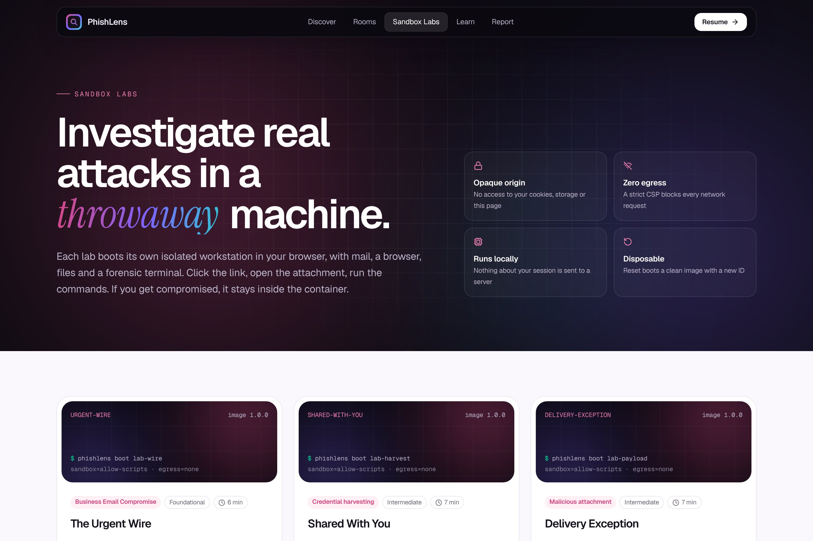
  <p><em><strong>Sandbox Labs catalog:</strong> each lab is a versioned image that boots into its own container. Your best score per lab is remembered.</em></p>
</div>

Each lab boots a fresh **container**: a virtual desktop running entirely inside your browser tab. Learners investigate the way an analyst would, or deliberately click the bad link to see what happens. Either way, nothing leaves the container.

### What's inside a container

| App | What you can do |
| :--- | :--- |
| **Mail** | Read the inbox, reveal the real sender address, open **Show original** (raw headers with SPF / DKIM / DMARC), hover links to see their real destination in the status bar, save attachments, start a reply (the To: line exposes Reply-To hijacks), **Report phishing** |
| **Browser** | Visit the lab's virtual web. Inspect the padlock (**certificate issuer, age, organisation, SANs**), ask the **password vault** whether it knows the site, view page source. Unknown hosts are dropped at the sandbox firewall. |
| **Files** | See Downloads the way an OS shows it (extensions hidden), toggle **Show file extensions** to unmask `.pdf.exe`, open or delete files, meet the "Enable Content" macro prompt |
| **Terminal** | Forensic shell: `whois`, `dig`/`nslookup`, `file`, `sha256sum`, `strings`, `cat`, `intel <hash\|domain>`, `curl -I`, `expand <shortlink>`, `base64 -d`, `history`. Network tools (`ping`, `wget`, `ssh`) are refused. |
| **Directory** | Company phone book sourced from HR, not from any email. **Call** a colleague to verify a request out-of-band. |
| **Messages / Authenticator** | SMS and chat threads with linkified URLs, and an MFA app that receives push prompts with location, IP and number matching |

### Labs

| Lab | Attack family | What you practise |
| :--- | :--- | :--- |
| **The Urgent Wire** | Business Email Compromise | Display name vs real sender, Reply-To hijack, "passing" SPF/DKIM on a lookalike domain, WHOIS age, verifying a payment change by phone |
| **Shared With You** | Credential harvesting (adversary-in-the-middle) | Hover previews, short-link expansion, reading hostnames right-to-left, day-old DV certificates, password-vault mismatch |
| **Delivery Exception** | Malicious attachment | Hidden double extensions, file magic vs file name, hashing and threat intel, finding an `AutoOpen` macro, containing a compromise |

### A lab, step by step

<table>
  <tr>
    <td width="50%">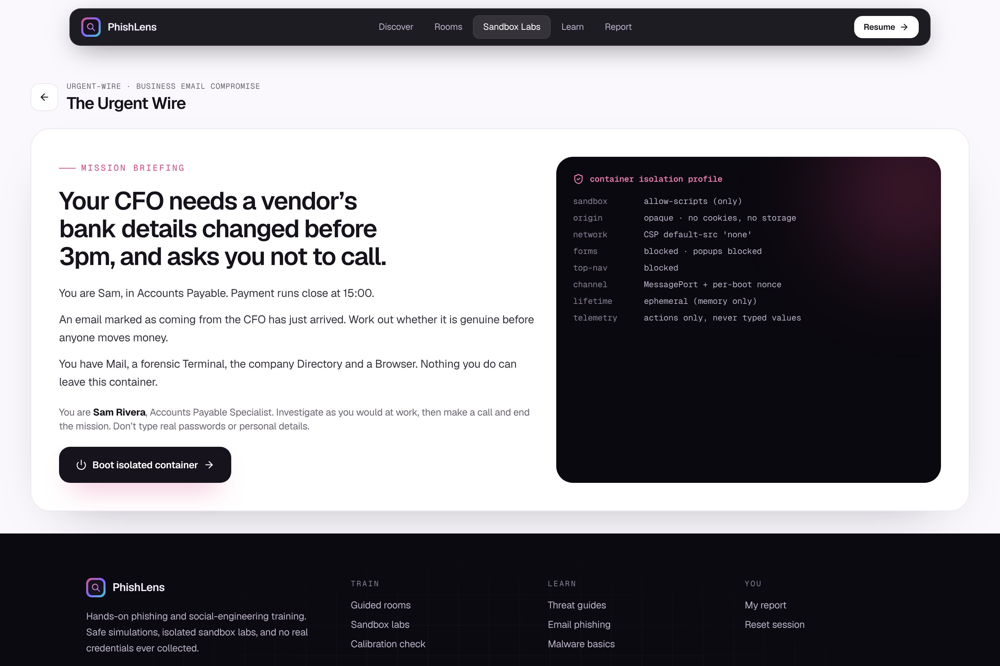<p align="center"><em>1 · Mission briefing and the container's isolation profile</em></p></td>
    <td width="50%">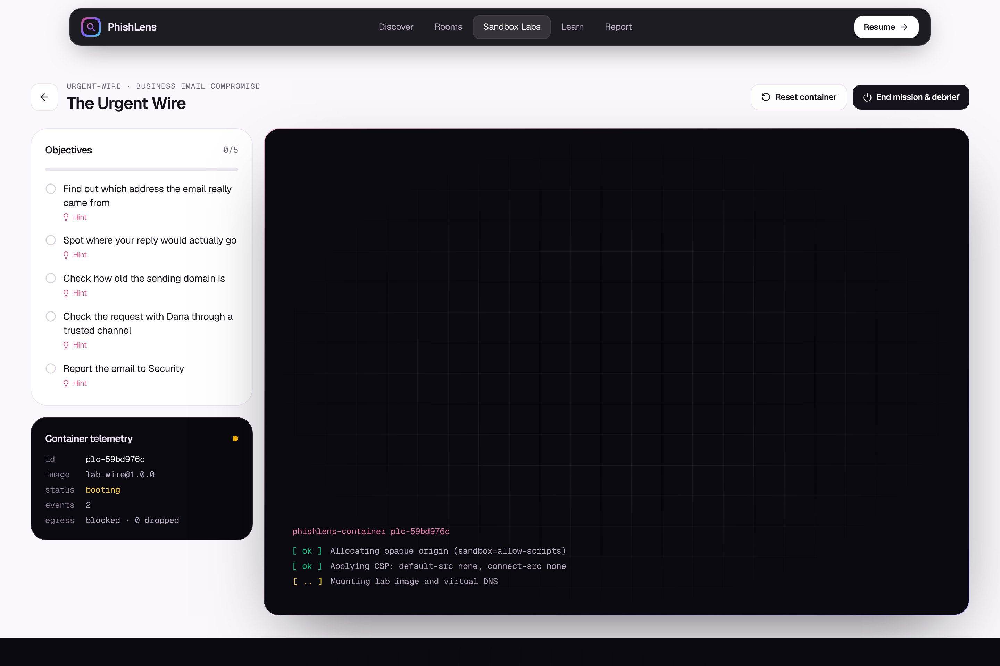<p align="center"><em>2 · Boot sequence: opaque origin, CSP, image, private channel</em></p></td>
  </tr>
  <tr>
    <td width="50%">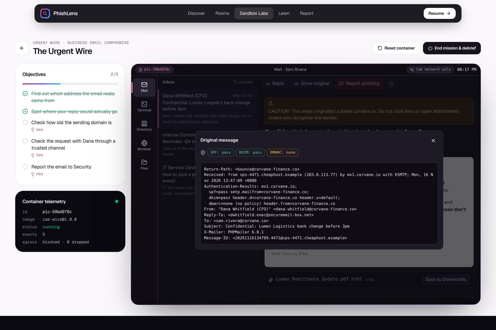<p align="center"><em>3 · Mail: raw headers expose the lookalike domain and Reply-To</em></p></td>
    <td width="50%">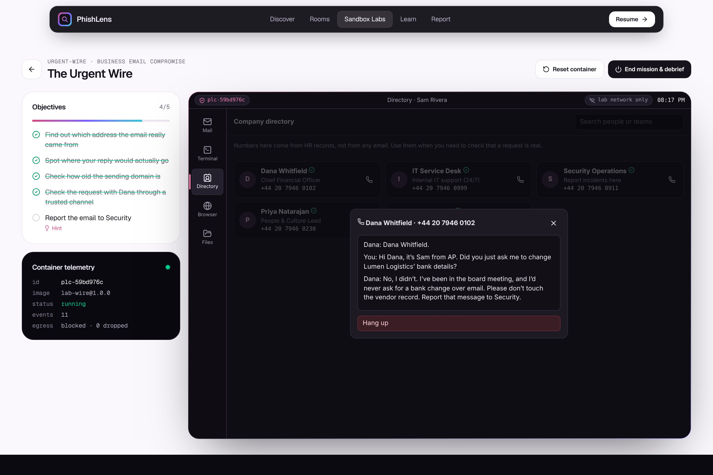<p align="center"><em>4 · Directory: verify out-of-band on a number HR holds</em></p></td>
  </tr>
  <tr>
    <td width="50%">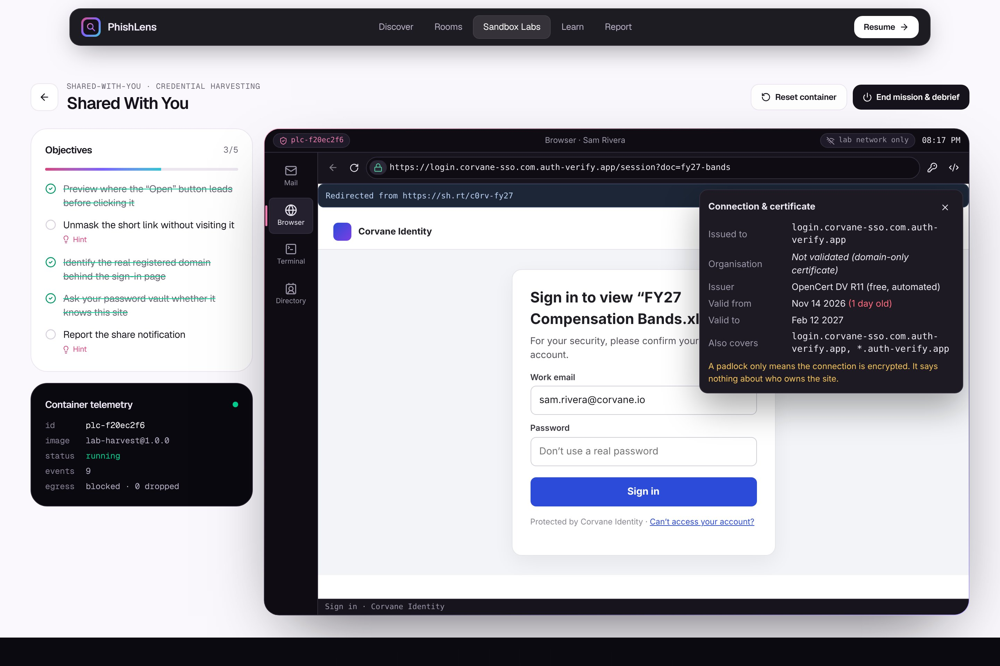<p align="center"><em>5 · Browser: a real padlock on a one-day-old, domain-only certificate</em></p></td>
    <td width="50%">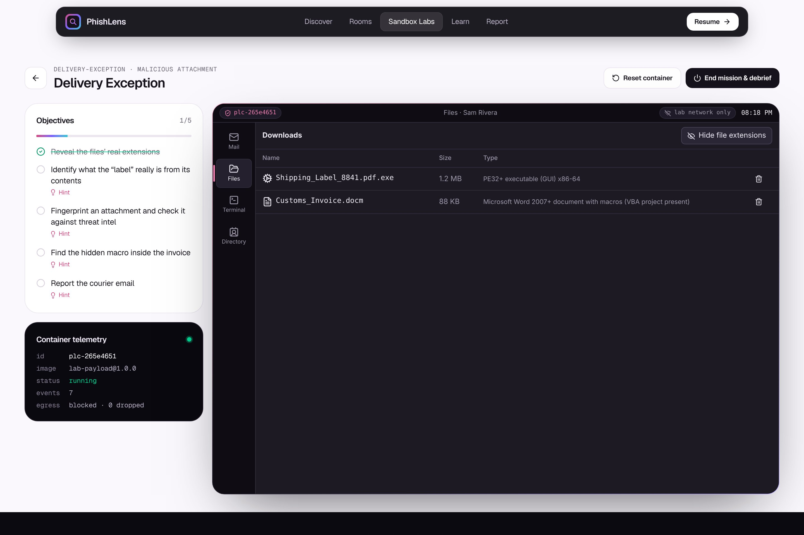<p align="center"><em>6 · Files: "Shipping_Label.pdf" is really a Windows executable</em></p></td>
  </tr>
  <tr>
    <td width="50%">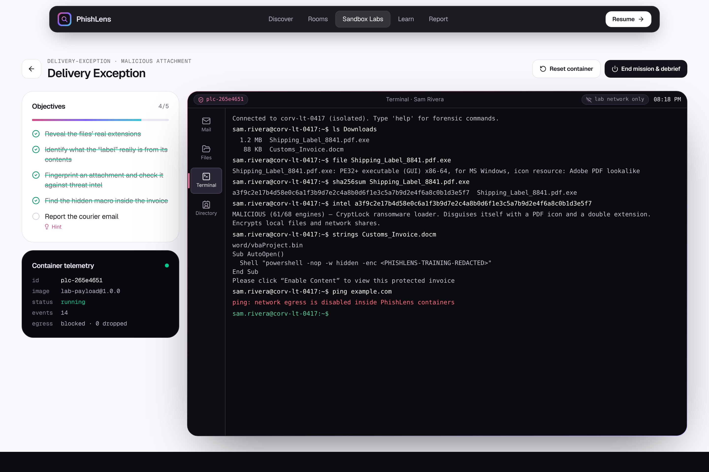<p align="center"><em>7 · Terminal: <code>file</code>, <code>sha256sum</code>, <code>intel</code> and <code>strings</code> confirm the payload without running it</em></p></td>
    <td width="50%">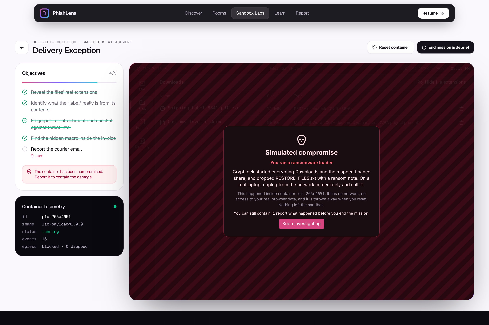<p align="center"><em>8 · Detonate it anyway: the compromise plays out only inside the container</em></p></td>
  </tr>
</table>

<div align="center">
  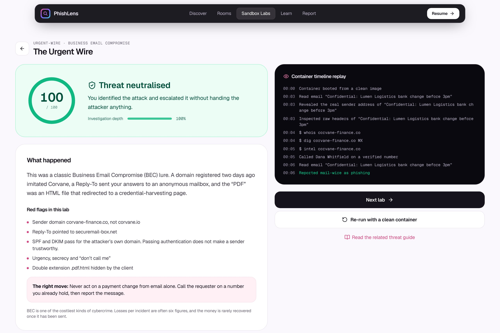
  <p><em><strong>Debrief:</strong> animated score ring, outcome (<em>Threat neutralised</em>, <em>Compromised, then contained</em>, <em>Container compromised</em> or <em>No verdict</em>), red flags, the right move, and a timestamped replay of every action taken inside the container.</em></p>
</div>


## Guided Simulation Rooms

<table>
  <tr>
    <td width="50%">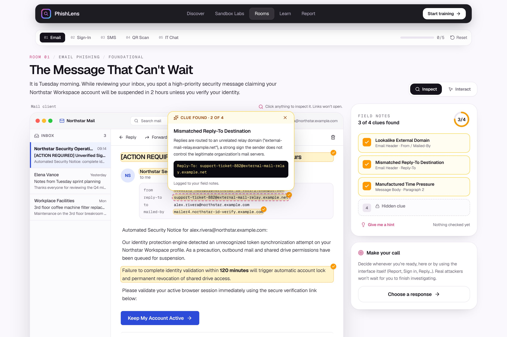<p align="center"><em>Room 01 · Email inbox triage with a task bar, hints and Evidence Log</em></p></td>
    <td width="50%">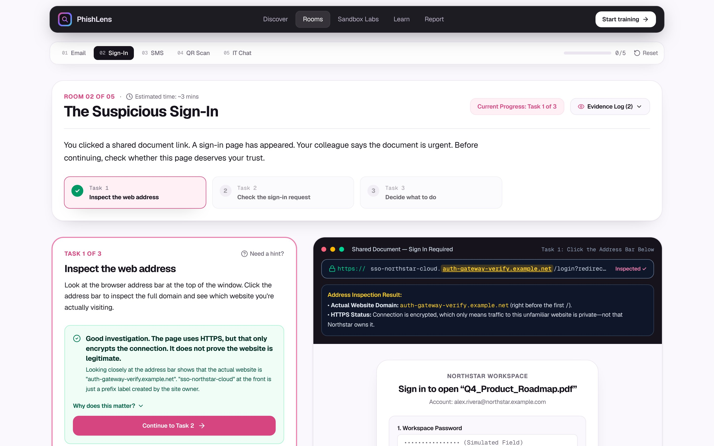<p align="center"><em>Room 02 · Inspecting a decoy-prefixed SSO address bar</em></p></td>
  </tr>
</table>

Every room follows the same loop: **Briefing → Task → Interact → Feedback → Reveal**. Each targets a high-impact vector and teaches one repeatable habit:

| Room | Title & Environment | Attack Vector | Interactive Clues to Inspect | Core Defensive Takeaway |
| :--- | :--- | :--- | :--- | :--- |
| **Room 01** | **The Message That Can't Wait**<br/>*Northstar Workspace Mail* | **Email Phishing**<br/>*(Urgency & Lookalike Domains)* | • 120-minute suspension countdown<br/>• Display name vs. actual sender (`northstar-id-verify.example.com`) & `Reply-To` mismatch<br/>• Button link preview (`session-check-auth.example.net`) | Display names and HTML styling are trivial to spoof. Always expand the sender header and check the domain before the first `/`. |
| **Room 02** | **The Suspicious Sign-In**<br/>*Browser SSO Portal* | **Credential Harvesting & AiTM Relay**<br/>*(Subdomain Decoys & HTTPS Myth)* | • Browser address bar (`sso-northstar-cloud.auth-gateway-verify.example.net`)<br/>• Valid TLS/HTTPS padlock issuer<br/>• Simultaneous password + 6-digit OTP input fields | An HTTPS padlock only means the connection is encrypted, not that the site is official. Read domain ownership right-to-left before the first `/`. |
| **Room 03** | **Your Delivery Is On Hold**<br/>*Smartphone SMS Thread* | **Smishing**<br/>*(Micro-Fee Lures & Mobile Links)* | • Unverified 10-digit mobile sender (`+1 (555) 017-8392`)<br/>• Harmless-sounding `$1.85` customs/redelivery fee<br/>• Hyphenated tracking URL (`swiftpost-parcel-redelivery.example.org`) | Tiny `$1–$2` fees are designed to get full card details without hesitation. Verify deliveries only in the official courier app. |
| **Room 04** | **Scan Before You Trust**<br/>*Office Poster + Mobile Camera* | **Quishing**<br/>*(QR Code Channel-Shifting)* | • Decoded QR camera preview URL (`device-enroll-auth.example.net`)<br/>• Poster instruction urging staff *not* to use their work laptop<br/>• Absence of any internal IT ticket or intranet path | QR codes move users from protected laptops onto personal phones. Always inspect the camera's URL preview before opening a QR link. |
| **Room 05** | **The Urgent IT Request**<br/>*Workplace Support Chat* | **Live Social Engineering**<br/>*(Authority Pretexting & OTP Theft)* | • `[External Guest Account]` sender badge<br/>• Pretexting with a real manager's name (*Elena Vance*)<br/>• Real-time SMS login OTP arriving while the agent asks for a "cancellation code" | Public org details (like manager names) don't prove identity, and no legitimate IT team will ever ask for your one-time passcode. |

After each decision, the **debrief** compares your action with the safest response and lists every clue as `✓ Inspected` or `○ Uninspected`, with the raw technical value and a plain-English explanation.

Room scenarios use reserved RFC 2606 domains (`.example.com`, `.example.net`, `.example.org`) and fictional personas.

---

## Personal Recognition Report

<div align="center">
  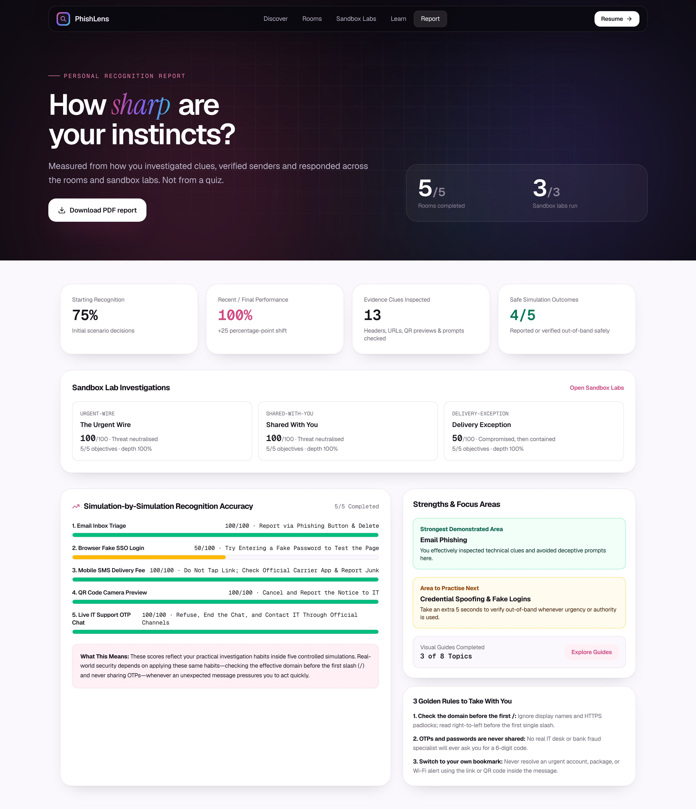
  <p><em><strong>/report:</strong> starting vs recent recognition with the percentage-point shift, clues inspected, safe outcomes, per-room accuracy bars, sandbox lab results, strengths and focus areas.</em></p>
</div>

- **Progress, not trivia.** Compares early decisions with later ones (or the baseline vs final calibration checks) to compute a **percentage-point shift**.
- **Investigation thoroughness.** Counts every header, URL, QR preview and prompt you actually inspected.
- **Sandbox lab results.** Best score per lab, outcome, objectives completed and investigation depth.
- **Strengths & focus areas.** Identifies your strongest category and the one to practise next.
- **PDF export (`src/lib/pdfExport.ts`).** A client-side A4 report generated with `jsPDF`.

---

## Threat Guides

<div align="center">
  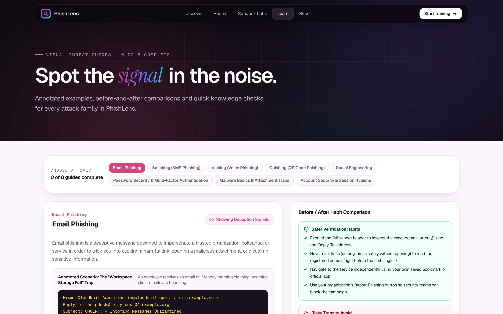
  <p><em><strong>/learn:</strong> 8 guides covering Email Phishing, Smishing, Vishing, Quishing, Social Engineering, Password & MFA Security, Malware & Attachment Traps, and Account Security. Each has an annotated artifact, a deception breakdown, safer habits vs risky traps, and a spot-check question.</em></p>
</div>

---

## Design System & Motion

The interface follows an editorial-meets-cinematic design: light, airy content surfaces broken up by dark "night" sections with aurora light, film grain and a faint grid.

<div align="center">
  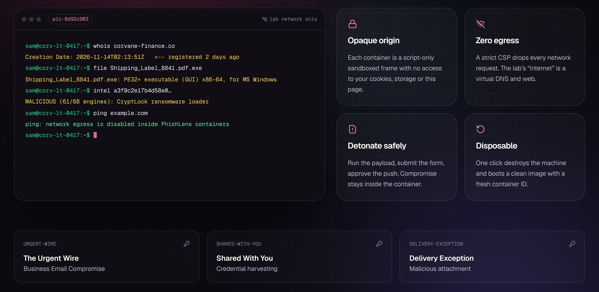
  <p><em>The landing page's sandbox showcase: a terminal that types itself as it scrolls into view, spotlight cards that follow the cursor, and lab tiles.</em></p>
</div>

**Tokens (`src/index.css`).** Every colour is a semantic Tailwind v4 theme token (`ink`, `muted`, `line`, `canvas`, `surface`, `brand`, `blush`, `violet`, `cyan`, `night`, …), so the whole palette can be retuned in one place. Typography is **Geist** (UI and display), **Instrument Serif** italic for accent words, and **Geist Mono** for code and telemetry.

**Motion primitives (`src/components/motion.tsx`).**

| Primitive | Used for |
| :--- | :--- |
| `SplitText` | Masked word-by-word headline reveals. `*words*` render in the gradient serif accent. |
| `Reveal`, `Stagger` | Scroll-triggered fade, lift and de-blur entrances |
| `Magnetic` | Buttons that lean toward the pointer on a spring |
| `SpotlightCard` | Cursor-following light and glowing border on cards |
| `Tilt`, `useParallax` | Subtle 3D tilt and scroll-linked parallax |
| `CountUp`, `Marquee`, `TypingTerminal` | Animated stats, the threat-family ticker, self-typing terminal sessions |
| `Aurora`, `ScrollProgress` | Drifting light backdrops and the top scroll-progress bar |

Plus: a floating glass navigation bar with a spring-animated active indicator and a full-screen mobile menu, blur page transitions, a scroll-driven learning-loop timeline, and the hero **threat scanner** (`src/components/HeroScanner.tsx`).

**Accessibility & performance.** The app is wrapped in `<MotionConfig reducedMotion="user">`, and continuous or pointer-driven effects check `prefers-reduced-motion`. With it on, the scanner shows its fully scanned state, typing completes instantly, and CSS animations collapse. Animations stay on `transform`, `opacity` and `filter`, and blur entrances end on `filter: none` so they never trap `position: fixed` descendants. The scanner pauses autoplay while it's off-screen.

<p align="center">
  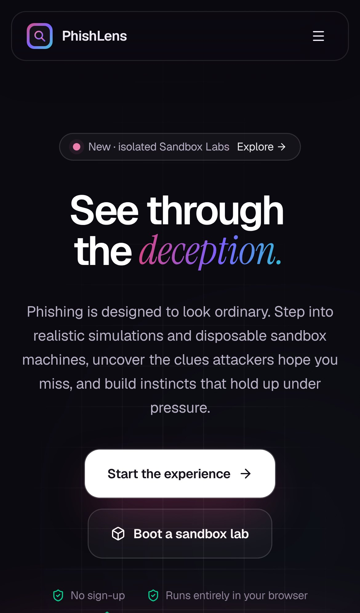
  <br /><em>Responsive down to phone widths, with a full-screen animated menu.</em>
</p>

---

## Architecture

PhishLens runs in two modes:

1. **Static edge mode (default).** Everything, including evaluation, session state, sandbox containers and PDF export, runs in the browser via `SessionStorageAdapter` and `localStorage`. It deploys as plain static files to Vercel, Netlify or Cloudflare Pages.
2. **Full-stack mode (`server.ts`).** An Express server adds REST endpoints (`/api/questions/:type`, `/api/scenarios`, `/api/modules`, `/api/assessments/evaluate`, `/api/simulations/evaluate`) with **Zod** validation and server-side answer-key isolation.

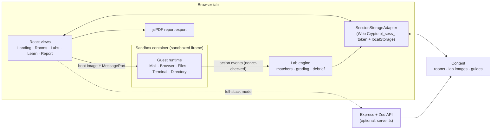

**Building the guest runtime.** A sandboxed frame with an opaque origin can't load module scripts from the app's server. A small Vite plugin (`vite.config.ts`) therefore compiles `src/sandbox/runtime/` with esbuild into a single IIFE, exposed as `virtual:phishlens-sandbox-runtime`. The host inlines it into each container's `srcdoc`. The runtime's source files are registered as watch dependencies of the virtual module.

**Session model.** An anonymous 192-bit `pl_sess_…` token from `crypto.getRandomValues`, with assessments, room feedback, inspected evidence, completed guides and `labResults` (best score per lab) persisted in `localStorage`. There's no sign-up and no personal data.

### Project structure

```text
PhishLens/
├── public/screenshots/               # README screenshots (captured from the running app)
├── src/
│   ├── components/
│   │   ├── AppShell.tsx              # Floating glass nav, rooms bar, page transitions, footer, reset dialog
│   │   ├── HeroScanner.tsx           # Interactive X-ray threat scanner (landing hero)
│   │   ├── WarmupTeaser.tsx          # 30-second interactive warm-up
│   │   ├── motion.tsx                # Motion primitives (SplitText, Reveal, Magnetic, SpotlightCard, …)
│   │   └── ui/                       # PageHero, Eyebrow
│   ├── sandbox/
│   │   ├── ContainerHost.tsx         # Boots isolated containers (sandbox attr, CSP, nonce, MessagePort)
│   │   ├── engine.ts                 # Deterministic lab grading, outcomes, timeline descriptions
│   │   ├── match.ts                  # Shared declarative event matcher
│   │   ├── types.ts                  # Lab image schema + host↔guest protocol
│   │   ├── labs/                     # Lab images: lab-wire, lab-harvest, lab-payload (+ shared content)
│   │   └── runtime/                  # Guest OS: Desktop, virtual network, apps/ (Mail, Browser, Files, Terminal, …)
│   ├── pages/
│   │   ├── LandingPage.tsx           # Hero, scanner, learning loop, rooms bento, sandbox showcase, warm-up
│   │   ├── LabsPage.tsx              # Lab catalog, workspace (objectives, telemetry, boot), debrief
│   │   ├── SimulationPage.tsx        # Guided rooms 01–05 + Evidence Log
│   │   ├── FeedbackPage.tsx          # Room debrief
│   │   ├── LearningCentrePage.tsx    # Threat guides
│   │   ├── AssessmentPage.tsx        # Baseline / final calibration
│   │   ├── IntroPage.tsx             # Safety & calibration intro
│   │   └── ReportPage.tsx            # Recognition report
│   ├── lib/                          # sessionStore.ts (session + evaluation), pdfExport.ts
│   ├── server/data.ts                # Room scenarios, rubrics, guides, assessments
│   ├── types/phishlens.ts            # Domain types (sessions, feedback, lab results)
│   ├── App.tsx                       # Client router + session orchestration
│   ├── index.css                     # Design tokens, utilities, keyframes
│   └── main.tsx                      # Entry, MotionConfig (reduced motion)
├── server.ts                         # Optional Express + Zod API with Vite middleware
├── vite.config.ts                    # Vite config + sandbox runtime plugin
└── vercel.json                       # SPA rewrites
```

---

## Tech Stack

| Layer | Technology | Purpose |
| :--- | :--- | :--- |
| **UI** | React 19, TypeScript 7 | Components, strict domain typing, simulation and lab state |
| **Styling** | Tailwind CSS v4 | Semantic theme tokens, custom utilities (glass, grain, grid, gradient text) |
| **Motion** | Motion (`motion/react`) | Scroll reveals, springs, layout animations, page transitions, reduced-motion support |
| **Sandbox** | Sandboxed iframes, CSP, `MessageChannel`, esbuild | Isolated, network-less, disposable lab containers |
| **Icons** | Lucide React | Interface and status iconography |
| **Reports** | jsPDF | Client-side PDF export |
| **Server (optional)** | Node.js, Express, Zod | API routes and payload validation |
| **Tooling** | Vite 8, tsx | Dev server, production build |

---

## Getting Started

### Prerequisites
- **Node.js** v20+ recommended
- **npm** v9+

### 1. Clone and install
```bash
git clone https://github.com/himohitj/PhishLens.git
cd PhishLens
npm install
```

### 2. Run the development server
```bash
npm run dev
```
The app starts on **`http://localhost:3000`**.

### 3. Type-check and build
```bash
npm run lint      # TypeScript type-check
npm run build     # Production bundle in /dist (includes the inlined sandbox runtime)
npm run preview   # Preview the production build
```

> No `.env` file or API keys are needed. Rooms, sandbox labs, sessions and PDF export all run self-contained.

### Adding a sandbox lab
1. Create `src/sandbox/labs/lab-<name>.ts` exporting a `LabImage` (see `src/sandbox/types.ts`): persona, apps, mail, files, virtual web pages, DNS/WHOIS, threat intel, timeline, objectives, traps and debrief.
2. Register it in `src/sandbox/labs/index.ts`.
3. Objectives and traps are `EventMatcher`s over container events (`mail_headers`, `cmd`, `navigate`, `form_submit`, `report`, …). There's no grading code to write.

---

## Deployment

### Vercel (recommended)
The included [`vercel.json`](./vercel.json) rewrites SPA routes (`/labs/*`, `/experience/*`, `/learn/*`, `/report`) to `index.html`.

1. Import the repository in [Vercel](https://vercel.com/).
2. Framework preset **Vite**, build command `npm run build`, output directory `dist`.
3. Deploy. No environment variables are needed.

### Node.js / Express (Render, Railway, Docker)
- **Build:** `npm install && npm run build`
- **Start:** `NODE_ENV=production npm start`
- **Port:** `3000`

---

## Author

**Mohit Jiwnani**
- GitHub: [@himohitj](https://github.com/himohitj)

---

## License

This project is licensed under the **MIT License**.
