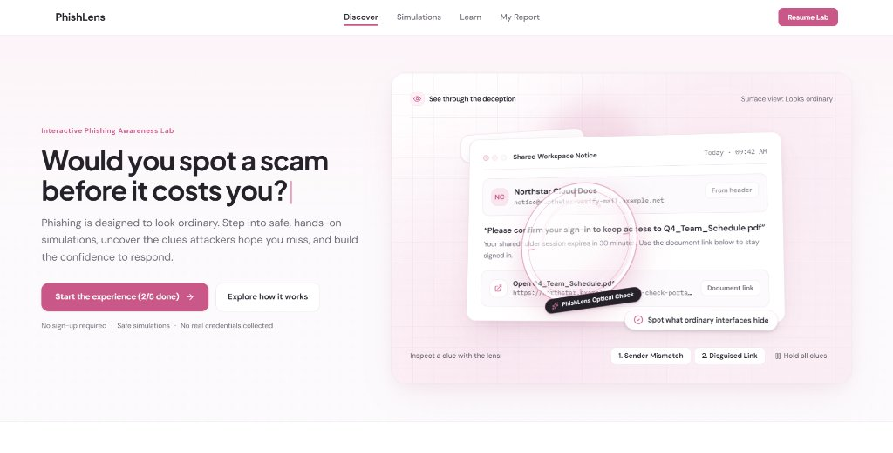
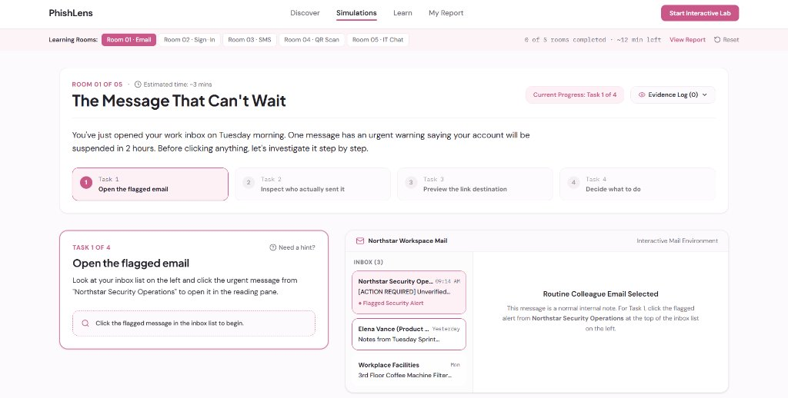
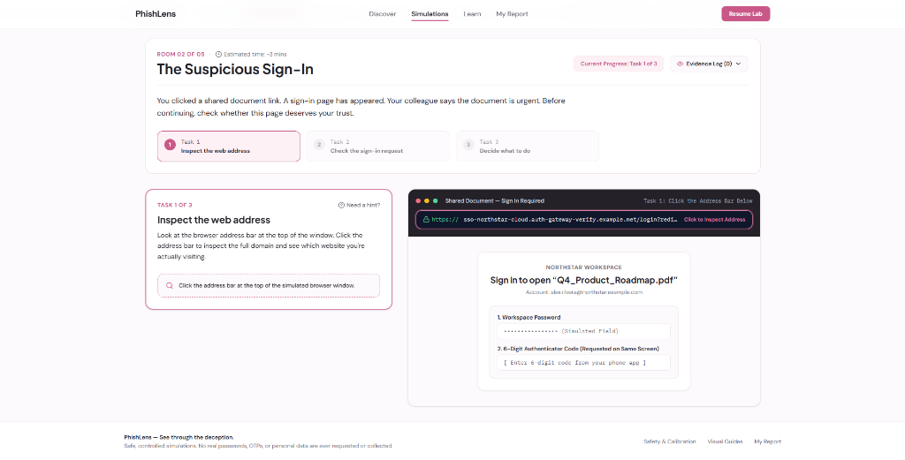
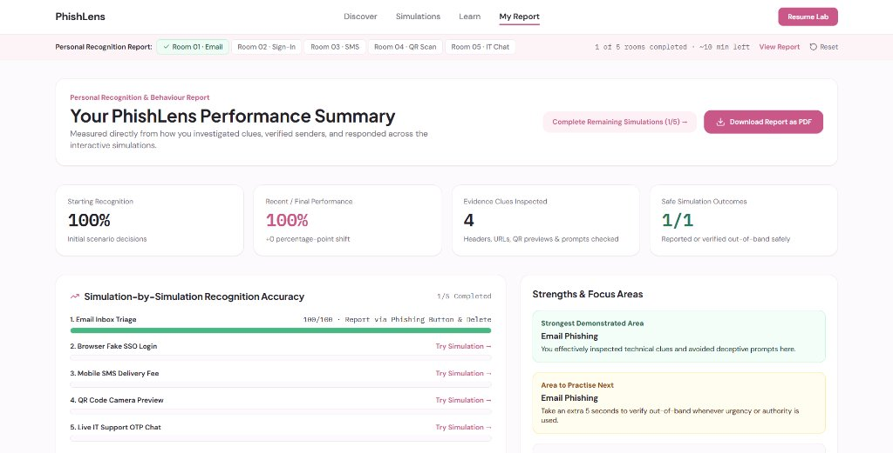
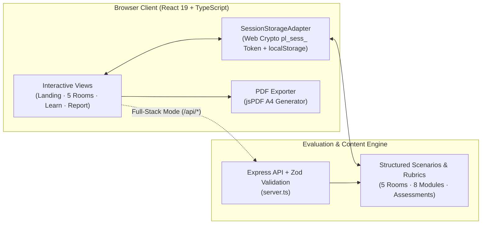

<div align="center">

# PhishLens

### **See Through the Deception — Interactive Phishing & Social-Engineering Simulation Lab**

[](https://react.dev/)
[](https://www.typescriptlang.org/)
[](https://tailwindcss.com/)
[](https://vitejs.dev/)
[](https://expressjs.com/)
[](https://zod.dev/)
[](#license)

<p align="center">
  <strong>PhishLens</strong> is a hands-on cybersecurity awareness and social-engineering training platform that replaces passive lecture slides with realistic, interactive digital environments. Users step directly into simulated email clients, browser login portals, mobile SMS threads, QR code camera scanners, and workplace support chats to investigate technical clues and build real-world defensive instincts.
</p>

<p align="center">
  <a href="#overview--philosophy">Overview</a> ·
  <a href="#key-features">Key Features</a> ·
  <a href="#interface-showcase">Interface Showcase</a> ·
  <a href="#the-5-interactive-simulation-rooms">Simulation Rooms</a> ·
  <a href="#personalised-recognition--behaviour-report">Performance Report</a> ·
  <a href="#system-architecture">Architecture</a> ·
  <a href="#getting-started">Getting Started</a> ·
  <a href="#deployment">Deployment</a>
</p>

</div>

---

## Preview

<div align="center">
  
  <p><em><strong>Discover View:</strong> Interactive 3D PhishLens Optical Check revealing a hidden sender domain mismatch and disguised login URL inside an ordinary-looking workspace notification.</em></p>
</div>

---

## Overview & Philosophy

Most phishing attacks succeed not because users lack theoretical awareness, but because modern interfaces hide technical indicators behind familiar display names, urgency countdowns, and visual polish. Traditional multiple-choice quizzes rarely prepare people for the split-second pressure of a real attack.

**PhishLens** was designed and built around a practical, action-first learning cycle:

$$\text{Experience} \longrightarrow \text{Decide} \longrightarrow \text{Discover} \longrightarrow \text{Understand} \longrightarrow \text{Practise} \longrightarrow \text{Improve}$$

Instead of asking abstract trivia questions, PhishLens places learners inside **five high-fidelity interactive simulation rooms**. Every room follows a structured 5-stage investigation loop:

```text
[ BRIEFING ]  ──►  [ TASK ]  ──►  [ INTERACT ]  ──►  [ FEEDBACK ]  ──►  [ REVEAL ]
```

1. **Briefing:** Understand the workplace or personal context (e.g., an urgent account suspension warning or a shared document sign-in prompt).
2. **Task:** Follow 3–4 guided investigative steps without being handed the answer upfront.
3. **Interact:** Click directly on email headers, browser address bars, hover link previews, QR camera viewfinders, and chat profile badges to uncover forensic clues.
4. **Feedback:** Receive immediate, contextual explanations for every clue discovered and every action taken.
5. **Reveal:** Review a complete post-scenario debrief comparing your decision against the safest response, alongside the underlying attack mechanics.

---

## Key Features

### 1. Five Multi-Step Interactive Simulation Rooms
- **Direct Manipulation Interfaces:** Each room replicates a distinct digital medium—an enterprise webmail inbox, a browser SSO login window, a smartphone SMS screen, a conference-room Wi-Fi poster with a mobile QR camera decoder, and a live workplace IT chat window.
- **Guided Task Progression & Hints:** Step-by-step tasks guide users through inspecting technical artifacts before making a final decision, with on-demand hints for learners who get stuck.
- **Live Evidence Log:** Every technical clue inspected inside a room is recorded in the session's **Evidence Log (`Evidence Log (N)`)**, rewarding thorough investigation with bonus recognition points.

### 2. Immediate Post-Simulation Debrief & Clue Breakdown
- **Action vs. Safest Response Comparison:** After choosing how to respond in any simulation room, learners see a side-by-side breakdown of their chosen action against the optimal defensive response.
- **Inspected vs. Missed Clues Audit:** Lists every forensic indicator present in the scenario, highlighting which clues the user actively inspected (`✓ Inspected`) versus overlooked (`○ Uninspected`), complete with raw technical values and plain-English explanations.

### 3. Personalised Recognition & Behaviour Report + PDF Export
- **Behavioural Analytics Dashboard:** Aggregates session performance across all five rooms and calibration checks, computing:
  - **Starting Recognition (%)** — Initial scenario decision accuracy.
  - **Recent / Final Performance (%)** — Post-simulation accuracy and measured **percentage-point shift**.
  - **Evidence Clues Inspected** — Total headers, URLs, QR previews, and prompts verified.
  - **Safe Simulation Outcomes** — Ratio of scenarios safely reported or verified out-of-band.
- **Strengths & Focus Area Identification:** Automatically determines the learner's **Strongest Demonstrated Area** and **Area to Practise Next** based on scenario scores and clue inspection habits.
- **One-Click PDF Export (`jsPDF`):** Generates a clean, multi-section A4 PDF report (`PhishLens_Report_<session>.pdf`) directly in the browser—including session metadata, scenario-by-scenario scores, category analysis, and practical security recommendations.

### 4. Visual Threat Guides & Spot-Check Learning Centre
- **8 Structured Threat Modules:** Deep-dive visual guides covering *Email Phishing*, *Fake Login Pages*, *Smishing*, *Quishing (QR Phishing)*, *Live Social Engineering & Pretexting*, *Password & MFA Resilience*, *Malware & Attachment Traps*, and *Account Security & Session Hygiene*.
- **Annotated Artifacts & Habit Comparisons:** Each module pairs a dark-mode annotated attack artifact with a toggleable deception breakdown, a **Safer Verification Habits (`✓`) vs. Risky Traps to Avoid (`✕`)** comparison, and an interactive 1-question spot-check quiz.

### 5. Zero-Friction Anonymous Sessions & 100% Safe Browser Sandbox
- **Cryptographic Opaque Session Tokens:** Visitors start immediately with zero sign-up or personal data collection. A 192-bit cryptographically random session ID (`pl_sess_...`) is generated via the browser Web Crypto API (`window.crypto.getRandomValues`) and persisted through a modular `SessionStorageAdapter`.
- **Isolated RFC 2606 Domains:** Every simulated email address, login URL, SMS shortlink, and QR code payload uses reserved `.example.com`, `.example.net`, and `.example.org` domains and pre-filled fictional personas—ensuring zero risk of accidental external navigation or credential exposure.

---

## Interface Showcase

### 1. Guided Simulation Room 01 — Enterprise Email Inbox Triage
<div align="center">
  
  <p><em><strong>Room 01 of 05 ("The Message That Can't Wait"):</strong> Multi-step task bar, live Evidence Log counter, contextual hint system, and interactive <code>Northstar Workspace Mail</code> environment for triaging an urgent account suspension alert.</em></p>
</div>

---

### 2. Guided Simulation Room 02 — Suspicious Browser SSO Login & MFA Relay
<div align="center">
  
  <p><em><strong>Room 02 of 05 ("The Suspicious Sign-In"):</strong> Simulated browser window challenging users to inspect the full address bar (<code>https://sso-northstar-cloud.auth-gateway-verify.example.net/login...</code>) and recognize the red flag of a login form requesting both a password and a 6-digit authenticator code on the same screen.</em></p>
</div>

---

### 3. Personalised Recognition & Behaviour Report Dashboard
<div align="center">
  
  <p><em><strong>My Report View:</strong> Comprehensive performance summary tracking Starting Recognition, Recent/Final Performance, Evidence Clues Inspected, Safe Simulation Outcomes, Simulation-by-Simulation Accuracy bars, Strengths & Focus Areas, and one-click PDF export.</em></p>
</div>

---

## The 5 Interactive Simulation Rooms

Each room targets a high-impact modern social-engineering vector and teaches a concrete, repeatable verification habit:

| Room | Title & Environment | Attack Vector | Interactive Clues to Inspect | Core Defensive Takeaway |
| :--- | :--- | :--- | :--- | :--- |
| **Room 01** | **The Message That Can't Wait**<br/>*Northstar Workspace Mail* | **Email Phishing**<br/>*(Urgency & Lookalike Domains)* | • 120-minute suspension countdown<br/>• Display name vs. actual sender (`northstar-id-verify.example.com`) & `Reply-To` mismatch<br/>• Button link preview (`session-check-auth.example.net`) | Display names and HTML styling are trivial to spoof. Always expand the sender header and check the domain before the first `/`. |
| **Room 02** | **The Suspicious Sign-In**<br/>*Browser SSO Portal* | **Credential Harvesting & AiTM Relay**<br/>*(Subdomain Decoys & HTTPS Myth)* | • Browser address bar (`sso-northstar-cloud.auth-gateway-verify.example.net`)<br/>• Valid TLS/HTTPS padlock issuer<br/>• Simultaneous password + 6-digit OTP input fields | An HTTPS padlock only means the connection is encrypted—not that the site is official. Read domain ownership right-to-left before the first `/`. |
| **Room 03** | **Your Delivery Is On Hold**<br/>*Smartphone SMS Thread* | **Smishing**<br/>*(Micro-Fee Lures & Mobile Links)* | • Unverified 10-digit mobile sender (`+1 (555) 017-8392`)<br/>• Harmless-sounding `$1.85` customs/redelivery fee<br/>• Hyphenated tracking URL (`swiftpost-parcel-redelivery.example.org`) | Attackers use tiny `$1–$2` fees so victims enter full payment card details without hesitation. Verify deliveries only in the official courier app. |
| **Room 04** | **Scan Before You Trust**<br/>*Office Poster + Mobile Camera* | **Quishing**<br/>*(QR Code Channel-Shifting)* | • Decoded QR camera preview URL (`device-enroll-auth.example.net`)<br/>• Poster instruction urging staff *not* to use their work laptop<br/>• Absence of any internal IT ticket or intranet path | QR codes move users from protected corporate laptops onto personal phones. Always inspect the camera URL preview before opening a QR link. |
| **Room 05** | **The Urgent IT Request**<br/>*Workplace Support Chat* | **Live Social Engineering**<br/>*(Authority Pretexting & OTP Theft)* | • `[External Guest Account]` sender badge<br/>• Pretexting with a real manager's name (*Elena Vance*)<br/>• Real-time SMS login OTP arriving while the agent asks for a "cancellation code" | Public org details (like manager names) do not prove identity, and no legitimate IT team will ever ask for your 6-digit one-time passcode. |

---

## Personalised Recognition & Behaviour Report

At any point during or after the lab, visiting **`/report` (`My Report`)** synthesizes the user's telemetry into an actionable summary:

- **Quantitative Progress Tracking:** Compares initial recognition decisions against later simulation performance (or Baseline vs. Final Calibration checks) to compute a net **percentage-point shift**.
- **Investigation Thoroughness Score:** Counts every technical clue inspected across all five rooms, reinforcing the habit of verifying technical evidence before acting.
- **Granular Scenario Breakdown:** Displays visual progress bars (`0–100`) and the exact action chosen for each of the 5 simulations, with direct links to retry or review any room.
- **Client-Side PDF Generation (`src/lib/pdfExport.ts`):** Uses `jsPDF` to render a structured A4 report containing:
  1. *Assessment Performance Summary* (Baseline %, Final %, Measured Change)
  2. *Interactive Phishing Simulations* (Outcome classification, score out of 100, and selected action for all 5 rooms)
  3. *Category Strengths & Learning Progress* (Strongest area, recommended practice area, and completed Learning Centre modules)
  4. *Practical Security Recommendations* (4 golden verification rules)

---

## System Architecture

PhishLens is engineered with a **dual-execution architecture**:
1. **Full-Stack Express + Vite Mode (`server.ts`):** Provides RESTful API endpoints (`/api/questions/:type`, `/api/scenarios`, `/api/modules`, `/api/assessments/evaluate`, `/api/simulations/evaluate`) with strict **Zod** request schema validation and server-side answer-key isolation.
2. **Zero-Config Static Edge Mode (`src/lib/sessionStore.ts`):** Executes deterministic evaluation and state persistence directly in the client via `SessionStorageAdapter` and `localStorage`, enabling instant serverless deployment on static hosts like **Vercel**, **Netlify**, or **Cloudflare Pages** without requiring external database credentials.



### Project Directory Structure

```text
PhishLens/
├── public/
│   └── screenshots/                  # Application interface screenshots used in documentation
│       ├── landing-optical-lens.jpg
│       ├── room-01-email-simulation.jpg
│       ├── room-02-signin-simulation.png
│       └── performance-report.jpg
├── src/
│   ├── components/
│   │   ├── AppShell.tsx              # Sticky 3-zone top navigation, guided context bar & reset modal
│   │   └── HeroLensScene.tsx         # 9-second deterministic 3D optical lens animation & clue controls
│   ├── lib/
│   │   ├── pdfExport.ts              # Client-side A4 PDF report generator (jsPDF)
│   │   └── sessionStore.ts           # Web Crypto session token generator, localStorage adapter & evaluators
│   ├── pages/
│   │   ├── LandingPage.tsx           # Hero section, 5-room overview & 30-second interactive warm-up sandbox
│   │   ├── IntroPage.tsx             # Sandbox safety guarantees & calibration introduction
│   │   ├── AssessmentPage.tsx        # Baseline & final scenario calibration checks
│   │   ├── SimulationPage.tsx        # Multi-step interactive engine for Rooms 01–05 + Evidence Log
│   │   ├── FeedbackPage.tsx          # Post-simulation action comparison & inspected clue breakdown
│   │   ├── LearningCentrePage.tsx    # 8 visual threat guides, annotated artifacts & spot-check quizzes
│   │   └── ReportPage.tsx            # Personal recognition & behaviour analytics dashboard
│   ├── server/
│   │   └── data.ts                   # Complete scenario definitions, scoring rubrics & learning modules
│   ├── types/
│   │   └── phishlens.ts              # Strict TypeScript interfaces for scenarios, sessions & telemetry
│   ├── App.tsx                       # Client-side router & top-level session state orchestration
│   ├── index.css                     # Tailwind CSS v4 imports, custom typography & editorial color tokens
│   └── main.tsx                      # React 19 application entry point
├── index.html                        # HTML5 entry document with Plus Jakarta Sans, DM Sans & IBM Plex Mono
├── server.ts                         # Express backend server with Zod validation & Vite middleware
├── tsconfig.json                     # TypeScript compiler configuration
├── vercel.json                       # SPA rewrite rules for seamless Vercel deployment
├── vite.config.ts                    # Vite bundler configuration
└── package.json                      # Project metadata, scripts & dependencies
```

---

## Tech Stack

| Layer | Technology | Purpose |
| :--- | :--- | :--- |
| **Frontend UI** | **React 19**, **TypeScript** | Component architecture, strict domain typing, and interactive simulation state |
| **Styling & Design System** | **Tailwind CSS v4** | Editorial Cloud-White (`#FCFAFC`) & Berry-Rose (`#D94F89`) palette, responsive 12-column layouts |
| **Animations & 3D Stage** | **Motion (`motion/react`)** | 3D CSS perspective transforms (`HeroLensScene`), smooth route transitions, and reduced-motion support |
| **Icons & Visual Cues** | **Lucide React** | Semantic security, mail, browser, QR, and status iconography |
| **Report Generation** | **jsPDF** | Client-side generation of downloadable A4 PDF performance summaries |
| **Backend & Validation** | **Node.js**, **Express**, **Zod** | API routes, payload validation, and answer-key isolation in server mode |
| **Build Tooling** | **Vite**, **tsx** | Fast HMR development server and optimized production asset bundling |

---

## Getting Started

### Prerequisites
- **Node.js** `v18.0.0` or higher (`v20+` recommended)
- **npm** `v9+`

### 1. Clone the Repository
```bash
git clone https://github.com/himohitj/PhishLens.git
cd PhishLens
```

### 2. Install Dependencies
```bash
npm install
```

### 3. Start the Development Server
```bash
npm run dev
```
The application will start on **`http://localhost:3000`**.

### 4. Type-Check & Build for Production
```bash
# Run TypeScript compiler type-checking
npm run lint

# Build optimized production bundle into /dist
npm run build

# Preview production build locally
npm run preview
```

> **Note:** No `.env` file or external API keys are required. All simulations, evaluations, session tokens, and PDF exports run self-contained out of the box.

---

## Deployment

### Deploying to Vercel (Recommended)
This repository includes a pre-configured [`vercel.json`](./vercel.json) that routes all SPA paths (`/experience/*`, `/learn/*`, `/report`) cleanly to `index.html`.

1. Push this repository to your GitHub account.
2. Open [Vercel](https://vercel.com/) and click **Add New... → Project**.
3. Import your **PhishLens** repository.
4. Confirm the build settings (auto-detected by Vercel):
   - **Framework Preset:** `Vite`
   - **Build Command:** `npm run build`
   - **Output Directory:** `dist`
5. Click **Deploy**. No environment variables are needed.

### Deploying as a Node.js / Express Service (Render, Railway, Docker)
If you prefer to run the full Express server (`server.ts`):
- **Build Command:** `npm install && npm run build`
- **Start Command:** `NODE_ENV=production npm start`
- **Port:** `3000`

---

## Author

**Mohit Jiwnani**
- GitHub: [@himohitj](https://github.com/himohitj)

---

## License

This project is licensed under the **MIT License**.
